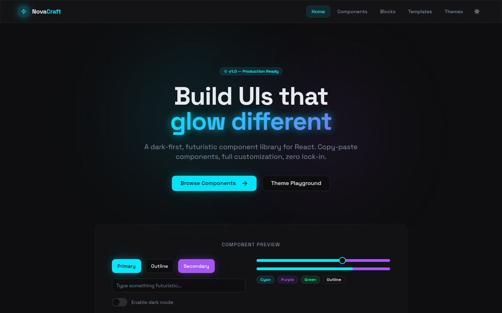
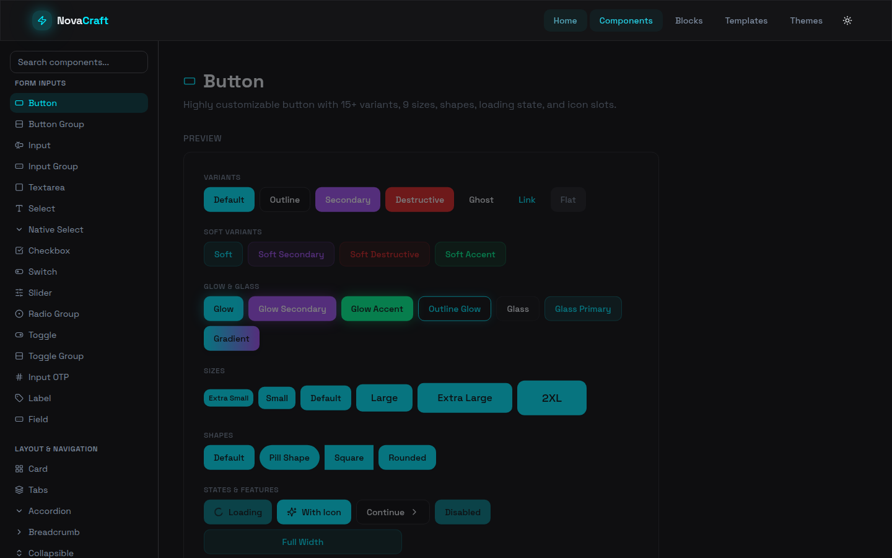
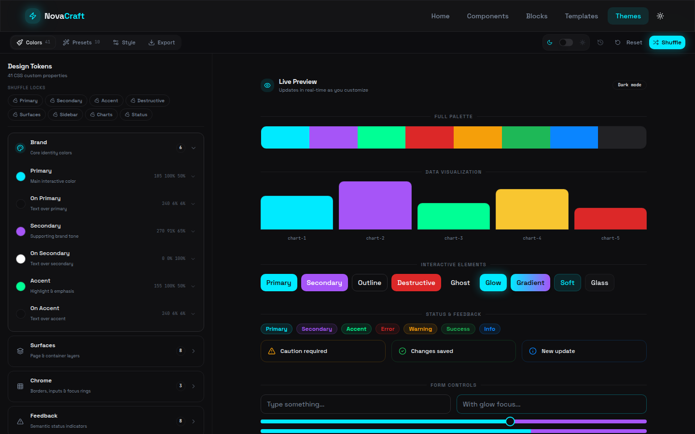

# NovaCraft UI

A dark-first React component library and documentation site. Copy the primitives in `src/components/ui`, theme them with CSS variables, and ship interfaces with glass, glow, and gradient treatments.

[](https://github.com/fabwaseem/novacraft-ui/actions/workflows/ci.yml)
[](LICENSE)
[](https://react.dev/)
[](https://www.typescriptlang.org/)
[](https://vite.dev/)
[](https://tailwindcss.com/)



## Features

- **Dark-first** — designed for dark mode, with a light theme one toggle away
- **Glass and glow** — frosted surfaces, glow, gradient, and soft variants on the same primitives
- **Themeable** — colors, radius, type, and effects are CSS variables you can edit in the theme playground
- **Accessible** — labeled controls, keyboard support, skip link, and visible focus treatment
- **Typed** — TypeScript components with exported variant types
- **Composable** — small primitives that combine into blocks and full-page templates
- **Copy-paste** — no package lock-in; drop a component into your app

## Components

Fifty-four documented components, grouped the same way as the docs site:

| Group | Components |
| --- | --- |
| Form inputs | Button, Button Group, Input, Input Group, Textarea, Select, Native Select, Checkbox, Switch, Slider, Radio Group, Toggle, Toggle Group, Input OTP, Label, Field |
| Layout and navigation | Card, Tabs, Accordion, Breadcrumb, Collapsible, Aspect Ratio, Separator, Resizable, Scroll Area, Navigation Menu, Pagination, Menubar, Calendar |
| Data display | Table, Data Table, Badge, Avatar, Progress, Skeleton, Spinner, Kbd, Typography, Empty |
| Feedback and overlays | Toast, Sonner, Alert, Alert Dialog, Tooltip, Popover, Dialog, Sheet, Drawer, Hover Card, Context Menu, Dropdown Menu, Command, Combobox, Date Picker |

`src/components/ui` also includes Form, Chart, Carousel, and Sidebar.

## Screenshots

Home, the component catalog, and the theme playground:

| Home | Components | Themes |
| --- | --- | --- |
|  |  |  |

## Install

```bash
git clone https://github.com/fabwaseem/novacraft-ui.git
cd novacraft-ui
npm install
```

```bash
npm run dev        # docs site at http://localhost:8080
npm run lint       # eslint
npm run typecheck  # tsc -b
npm test           # vitest
npm run build      # production build
npm run preview    # serve the production build
```

## Usage

Copy `src/lib/utils.ts` and the component you need from `src/components/ui`. Point the `@` alias at your source root, and bring over the CSS variables in `src/index.css` (or generate them from the theme playground).

```tsx
import { Button } from "@/components/ui/button";

export function Example() {
  return (
    <Button variant="glow" size="lg">
      Get started
    </Button>
  );
}
```

Buttons default to `type="button"`. Pass `type="submit"` when the button should submit a form. Variants include `default`, `outline`, `ghost`, `glass`, `glow`, `gradient`, and `soft`.

## Stack

- React 18 and React Router 6
- TypeScript 5.9
- Vite 5
- Tailwind CSS 3 and Radix UI primitives
- Framer Motion
- class-variance-authority, clsx, and tailwind-merge
- Vitest and Testing Library

## Documentation

The site in this repo is the docs:

- `/` — overview
- `/components` — component previews, usage, and props
- `/blocks` — section patterns
- `/templates` — full-page layouts
- `/themes` — live theme editor

Published docs: [novacraft-ui.vercel.app](https://novacraft-ui.vercel.app)

## License

[MIT](LICENSE) © [Waseem Anjum](https://github.com/fabwaseem)

## Contributing

Open a pull request. CI runs lint, typecheck, tests, and the production build.
